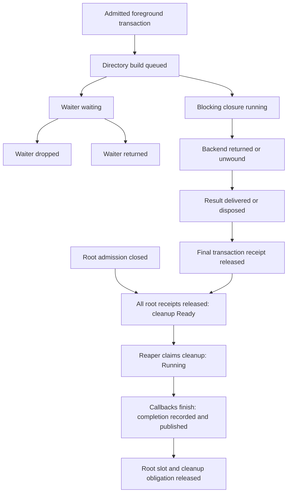

# Owner-local filesystem snapshots

`FsCompletion::try_snapshot()` reads one filesystem root's existing ownership
state. Host Rust code that already holds `FsCompletion` can request a snapshot.
The API adds no guest capability, RPC method, HTTP endpoint, or global registry.
This is the filesystem slice of [#779](https://github.com/wetware/ww/issues/779)
under [#756](https://github.com/wetware/ww/issues/756).

## Source and ownership

`HostFsOwner` owns the filesystem driver, bounded root table, and cleanup thread
in `crates/cache/src/fs_driver.rs`. Each registered root has a `State` in
`crates/cache/src/fs_work.rs`. Its `Lifecycle` mutex already protects admission,
work receipts, cleanup claim, recorded failures, and cleanup completion.

`FsOwner` and `FsFinalizer` close root admission. `FsScope` admits work and
registers cleanup. `FsWorkToken` retains a work receipt until its owner drops it.
`NativeFsLease` in `crates/cell/src/fs_intercept.rs` carries a receipt through
native Wasmtime filesystem work. `ForegroundTransaction` continuations share
receipts; result envelopes can retain those receipts after a backend returns.
`FsCompletion::wait()` retains the existing frozen completion result.

The snapshot copies existing ownership fields and bounded directory-build records
from the same lifecycle mutex. It uses no TLS enrollment, grant routing, worker
counter sharding, or separate operation registry. Existing fuel collectors remain
independent of this API.

## Contract

`FsSnapshot` is a fixed-size value with read-only accessors:

| Accessor | Meaning |
| --- | --- |
| `root()` | Opaque slot/incarnation identity, comparable only within one `HostFsOwner` lifetime. |
| `root().generation()` | Existing slot generation. Changes on reuse; not a snapshot sequence. |
| `captured_at()` | Process-local monotonic `Instant` captured under the lifecycle mutex. |
| `root_admission_open()` | Root admission flag. Host closure or resource limits can independently reject work. |
| `outstanding_work()` | Outstanding ownership receipts, not individual operations or bytes. |
| `cleanup()` | `Pending`, `Ready`, `Running`, or `Completed`, as defined below. |
| `cleanup_poisoned()` | A recorded cleanup failure poisoned new cleanup-bearing admission. |
| `failure_recorded()` | Whether the root recorded any failure. No failure text is copied. |
| `directory_builds()` | Eight optional selected native directory-build records; see below. |
| `omitted_directory_builds()` | Saturating lifetime count of observations omitted because all slots were occupied or operation IDs were exhausted. |

Cleanup phase derives from the existing fields, in this order:

1. `Completed`: the reaper finished callbacks and set `finished`.
2. `Running`: the reaper claimed cleanup and has not set `finished`.
3. `Ready`: root admission is closed, work is zero, and cleanup is unclaimed.
4. `Pending`: root admission remains open or work receipts remain.

`Running` covers the entire claimed interval, including gaps between callbacks.
`Completed` does not mean success: inspect `failure_recorded()` and use `wait()`
for the completion result. It also does not certify root-table removal or permit
release, which follow completion recording. Completion recording precedes watch
notification. Existing code can record a late failure, so a later live snapshot
can differ from the frozen `wait()` result.

Guest cancellation does not prove native completion. Zero work does not prove
cleanup completion. A nonzero receipt count can describe retained results after
native completion. Ordinary I/O errors are not necessarily recorded failures.
The API identifies individual directory builds within a root generation. It does
not observe guest cancellation requests, backend timestamps, or failure text.

## Native P3 directory-build slice

P3 `open-at` materializes a CID-backed directory through `build_directory` in
`crates/cell/src/fs_intercept.rs`. The selected closure creates a temporary
directory, populates entries, then publishes with `renameat_with`. It performs
rollback before returning an error. `ForegroundTransaction::run_directory_build`
observes this closure through the existing retained `run_blocking` execution.

Each `FsDirectoryBuildSnapshot` reports four independent facts:

| Accessor | Producer and meaning |
| --- | --- |
| `id()` | Monotonic operation sequence within this root generation. Correlate with `root()`, not across host owners. |
| `waiter()` | `Waiting` until the selected wrapper returns (`Returned`) or is dropped first (`Dropped`). This describes the directory-build waiter, not the entire P3 call or Cell. |
| `backend()` | `Queued` before closure entry, `Running` during the closure, `Succeeded` or `Failed` after the closure returns, `Panicked` on unwind, or `NotExecuted` when the closure is destroyed without entry. |
| `receipt()` | `Outstanding` until the existing shared transaction's root receipt is dropped, then `Released`. Subsequent serial phases or result envelopes can retain the receipt after backend completion. |

Dropping the waiter does not cancel retained backend work. Dropping the async
wrapper before its first poll submits no work and creates no record. Ordinary
backend errors set `Failed` without changing existing root-failure semantics.
Panic handling and root failure recording remain those of `run_blocking`.

Guest cancellation currently does not cancel this selected native backend
operation. [#785](https://github.com/wetware/ww/issues/785) owns the correctness
decision and any cancellation changes. This diagnostic observes existing behavior;
continued execution is not evidence that an independent Host owner needs it.

The pinned Wasmtime `FilesystemOperation` hook exposes admission and final
opaque-owner release only. A stream session or retained result can outlive a
backend return. `NativeFsLease` therefore cannot supply these backend phases;
delegated native operations remain outside this slice. No aggregate receipt
count is interpreted as an individual operation.

The eight slots belong to the existing root `Lifecycle`. Every receipt carries
an eight-bit slot mask. `FsWorkToken::drop` marks its records `Released` under
the same mutex that decrements `outstanding_work`. Observation handles hold weak
references and add no receipt, permit, or cleanup authority.

A slot remains reserved until its waiter and backend terminate and its receipt
is released. New builds replace the oldest fully retired record when no empty
slot remains. Full slots or exhausted sequence IDs omit diagnostics without
rejecting execution. A nonzero omission count means the records cannot certify
absence of active builds. Replacement does not increment the omission count;
the records are bounded observations, not a complete event history. Root reuse
starts empty records and a new root generation.

## Consistency, freshness, and resource bounds

Each successful read acquires the root mutex once with `try_lock` and copies
fixed-size fields. All fields describe the same root state while that mutex is
held. The snapshot does not combine host admission, permits, other roots, or
`Store` state. Root identities can repeat across separate host owners or restarts.

`FsCompletion` holds a weak reference for diagnostics. A call temporarily upgrades
the reference; holding the completion handle or snapshot does not retain work,
cleanup authority, or a live root. The weak reference retains the allocation's
control block after the root's contents are released, until the handle is dropped.

The call returns one of three errors instead of cached or partial data:

- `Busy`: the lifecycle mutex is held; the call did not wait or queue.
- `Unavailable`: no live root state remains. The completion result can remain
  available through `wait()` independently.
- `Poisoned`: the mutex cannot provide certified state.

There is no stale fallback, timeout queue, root scan, background task, event history,
or diagnostic allocation per read. Only one reader holds the lifecycle mutex at
a time. Other concurrent reads return `Busy`. The critical section copies a
constant number of fields and captures one clock value. It does not await,
invoke callbacks, format messages, or acquire another lock. Scheduling can delay
a thread; this is not a hard real-time wall-clock guarantee.

The snapshot becomes historical as soon as capture ends. Consumers can compare
`captured_at()` with their own monotonic deadline. Consumers that retry `Busy`
must bound attempts or elapsed time. The API does not infer owner shutdown from
admission closure. After shutdown, a retained `FsScope` can still expose completed
state; after all strong references disappear, reads return `Unavailable`.

Existing lock order remains unchanged: table operations release the root-table
mutex before wake notification; candidate scans release it before lifecycle reads.
Root close and work release unlock lifecycle before wake notification. Cleanup
callbacks run outside those locks. Completion publication unlocks lifecycle before
watch access. Table removal drops its root reference outside the table lock, then
the reaper releases the cleanup obligation through its separate mutex.

## Internal consumer

`OwnedChildLifecycle::run_until_shutdown` in `src/launcher.rs` reads the existing
completion handle after guest exit and before waiting for filesystem cleanup.
With launcher trace logging enabled, one event contains the snapshot or explicit
read error. For example, set `RUST_LOG=ww::launcher=trace` for the host process.
The tracing macro does not evaluate the read when the callsite is disabled.
After `wait()` resolves, a second event reports
`executor: child filesystem completion observed` with `succeeded`. Both events
inherit the existing Cell correlation span. No polling service is added.
Both filesystem events use trace level; normal completion emits no additional
info/debug filesystem event. The typed snapshot remains available on demand.
Cleanup certification failures retain their existing error event.

These are producer-side fields. The default [Host logging subscriber](logging.md)
redacts the Debug-formatted snapshot and the non-allowlisted `succeeded` boolean,
even at TRACE; their uncatalogued messages become `unclassified event (text redacted)`.
Use the typed `FsCompletion` API to inspect these details. The tracing tests use
a separate subscriber that retains the producer fields.

The events contain owner-local identity, timestamp, receipt count, typed phases,
bounded operation records, omission count, and booleans. They contain no paths,
CIDs, capabilities, or error text.
Root identities are not Prometheus labels. The event does not change the existing
completion wait or delegated-authority release sequence.

For example, a guest-exit snapshot containing `waiter: Dropped`,
`backend: Running`, and `receipt: Outstanding` proves that selected backend work
survived its waiter. A later typed read can show `Succeeded` with cleanup
`Running`. The completion event reports the independent final wait result even
when the weak snapshot source has become `Unavailable`. Snapshot reads can
return `Busy`; consumers must preserve that uncertainty.

The real compiled P3 test
`native_p3_directory_cancellation_distinguishes_backend_and_cleanup_completion`
gates directory publication, kills the Cell, verifies Store destruction, then
holds cleanup separately. Native file contents and deletion independently
witness publication and cleanup. Cache tests cover queued cancellation,
failure, panic, concurrency, retention, bounds, generation reuse, and shutdown.

## Extension boundary

[#780](https://github.com/wetware/ww/issues/780) extends #779's read contract for
one directory-build lifecycle. Broader filesystem, stream, and transport
operations, bytes/backpressure, memory/resource visibility, trap classification,
and profiling remain under #753. The broader agent interface remains under #756.
