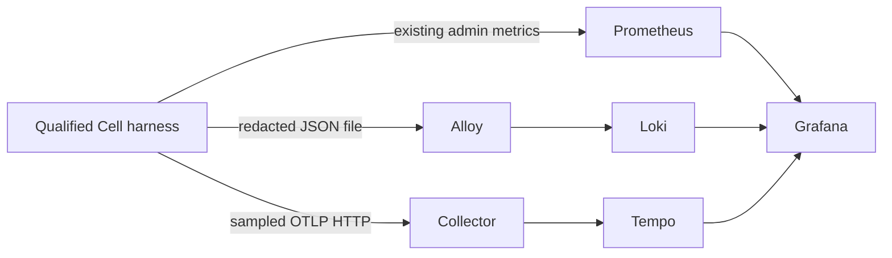

# Local Cell lifecycle investigation

This stack joins existing aggregate metrics, redacted Host JSON logs, and sampled
Cell traces from the qualified incident harness. It runs locally without cloud
services or production changes.
The [foundation audit](observability-foundation.md) identifies the landed
instrumentation and explains its limits.

## Components and boundaries

| Component | Pinned version | Input and purpose | Local endpoint |
| --- | --- | --- | --- |
| Prometheus | 3.5.0 | Scrapes the real admin `/metrics` every 2 seconds | `http://127.0.0.1:19090` |
| OpenTelemetry Collector | 0.136.0 | Accepts OTLP/HTTP; forwards bounded batches to Tempo | `http://127.0.0.1:14318/v1/traces` |
| Tempo | 2.9.0 | Stores sampled traces | `http://127.0.0.1:13200` |
| Loki | 3.5.5 | Stores JSON log records | `http://127.0.0.1:13100` |
| Alloy | 1.10.2 | Reads only `.context/observability/runtime.jsonl` | Internal only |
| Grafana | 12.2.0 | Provisions three data sources and one dashboard | `http://127.0.0.1:13000` |



Grafana runs with anonymous Viewer access and enables Explore through
`GF_USERS_VIEWERS_CAN_EDIT` for the pinned Grafana version. This setting also
permits temporary panel edits; provisioned dashboard changes cannot be saved.
All published ports bind to loopback.
The stack mounts no Docker socket and uses no cloud credentials.
This configuration is for a trusted local machine, not a shared deployment.
The runtime does not wait for stack readiness.

## Start and stop

Requirements: Docker with Compose, Python 3.11 or newer, the repository Rust prerequisites, and at
least 3 GiB available to the Docker VM in addition to Rust build memory.
The six service memory limits total 2,304 MiB. Image downloads require additional
disk space. The first Rust build is substantially larger than this stack.

Run from the repository root:

```sh
sh dev/observability/stack.sh config --quiet
sh dev/observability/stack.sh up -d
sh dev/observability/stack.sh ps
curl --fail http://127.0.0.1:19090/-/ready
curl --fail http://127.0.0.1:13200/ready
curl --fail http://127.0.0.1:13100/ready
curl --fail http://127.0.0.1:13000/api/health
```

Loki and Tempo can take about one minute to become ready. Inspect failures with
`sh dev/observability/stack.sh logs --tail=50`.

Open [the Cell lifecycle dashboard](http://127.0.0.1:13000/d/wetware-lifecycle).
The dashboard uses only existing lifecycle, executor, and fuel metric families,
plus the exporter drop counter. An empty panel means no matching samples were
scraped; it does not establish a zero value.

```sh
sh dev/observability/stack.sh down
```

All service data uses size-limited `tmpfs`. Stopping or recreating a container
discards that service's stored data. The runtime log and evidence files remain
under `.context/observability`; archive or remove those files separately.
Do not stop the stack before saving incident evidence.

## Runtime configuration

Trace export is disabled when `WW_OTLP_ENDPOINT` is absent. For a short local
investigation, set:

```sh
export WW_LOG_FORMAT=json
export RUST_LOG=ww=info,cell=info,cache=info,rpc=info
export WW_OTLP_ENDPOINT=http://127.0.0.1:14318/v1/traces
export WW_TRACE_SAMPLE_RATIO=1
export WW_TRACE_MAX_SPANS_PER_SECOND=100
```

`WW_TRACE_SAMPLE_RATIO=1` requests all eligible Cell roots for this small demo.
The enabled default is `0.01`. A ratio of `0` disables sampling. The shared
`RUST_LOG` filter must enable INFO Cell spans; terminal defaults use WARN.
Descendants
inherit their Cell root's decision. There is no network trace-context
propagation in this slice. The exporter generates `trace_id` and `span_id`;
the JSON formatter reads those identifiers from the same span context.

Only `scripts/observability-incident.py` must produce the
`.context/observability/runtime.jsonl` file ingested by this recipe. The harness
passes `tokio::io::sink()` for guest stdout and stderr. Its captured stderr
therefore contains Host formatter output without guest output.

Do not redirect a full `ww run` process's stderr into this file. `src/kernel.rs`
passes the process stderr directly to PID0, outside the Host formatter's
redaction policy. A guest can emit arbitrary bytes, including valid JSON that
imitates a Host event. JSON parsing does not establish provenance or redact
those guest bytes. Full Host log ingestion remains a follow-up that requires
an isolated Host formatter sink.

Alloy adds only fixed `job` and `service_name` labels. Trace IDs, Cell IDs,
CIDs, peers, capabilities and event fields are not Loki index labels or
Prometheus labels.

The demo admin server must be reachable from the Prometheus container at
`host.docker.internal:19091`. The recipe uses host loopback on macOS.
On Linux, use an explicitly selected Docker bridge address if host loopback is
not reachable; do not expose the admin server on an untrusted interface.
Set `WW_OBSERVABILITY_ADMIN=<selected-bridge-IP>:19091` when running
`scripts/observability-incident.py --mode live`. The script preserves that
explicit address and otherwise binds `127.0.0.1:19091`. Keep port `19091` so
the provisioned scrape target and evidence verifier continue to match.

## Reproduce the cost comparison

The baseline helper creates a detached local worktree at audited master
`f7881b75`. It copies the current probe and replaces only the post-measurement
`telemetry_metrics()` helper with a no-op because master has no exporter
counters. The measured Cell workload is unchanged. Both builds use the debug
profile and the shared build lock. Build logs, source paths and the baseline
executable hash remain under `.context/observability`.

```sh
python3 scripts/observability-baseline.py
python3 scripts/observability-incident.py --mode cost \
  --baseline .context/observability/rebuilt-master-probe \
  --output .context/observability/cost-comparison --repetitions 3
```

Keep the local stack running for the enabled campaign. Each process measures
30 Cells after five warmups; campaign order reverses on alternating repetitions.
These small debug workloads do not establish production throughput or zero overhead.

## Investigate the incident

The deterministic workload instantiates a real WASI P3 component inside a
production executor Cell task. Its start function does not finish. The existing
five-second instantiation timeout records event code `300` and increments
`ww_wasmtime_instantiations_total{outcome="timeout"}`.

The harness deliberately withholds epoch publication to make the timeout
reproducible. The telemetry does not record that test setup. An operator can
conclude that instantiation timed out; the operator cannot conclude why epoch
progress stopped from this evidence alone.

Run the real incident and then verify the three backend responses:

```sh
python3 scripts/observability-incident.py --mode live
python3 scripts/observability-evidence.py
```

The script serializes the build and workload using
`/tmp/ww-fuel-coordination/build-benchmark.lock`. The harness keeps the admin
endpoint alive for ten seconds before and after execution. The evidence script
writes `evidence-chain.json`, `trace.json`, `loki.json`, and `prometheus.json`
under `.context/observability`.

1. Confirm both commands succeed. Inspect the saved evidence and runtime log.
2. Open the dashboard. **Instantiation failures since process start** must show
   a timeout count. The metric is aggregate and has no direct trace exemplar.
3. Inspect **Lifecycle incident logs**. The query is
   `{service_name="wetware"} | json | fields_event_code="300"`.
   Check the timestamp, contract fields, and the recorded `timeout_ms`.
4. Expand the matching record and select **Open trace** on `trace_id`.
   Grafana uses the actual ID from that JSON record to query Tempo.
5. Inspect the `cell` span and its timeout event. Check the recorded duration
   against the configured deadline. This slice has no separate instantiation
   child span. The metric and log establish an instantiation timeout; the Cell span
   duration contains that interval, without decomposing its internal work.
   A sampled trace can be incomplete if later spans were dropped.
6. Use Tempo's logs link to return to records with the same `trace_id`.

The metric-to-log step uses time and the classified outcome. It does not prove
which Cell contributed an aggregate sample in a concurrent workload. The
single-workload recipe makes that association inspectable without inventing a
metric correlation identifier. Logs-to-trace navigation uses exact IDs.

Executor `completed` means the factory future returned. It does not mean the
guest succeeded. The dashboard preserves that distinction. The fuel panel
shows aggregate decisions; it does not describe a live Store's remaining fuel.

## Retention, failure and resource limits

Prometheus retains at most 24 hours or its 128 MB retention target. Its `tmpfs`
has a 256 MiB hard capacity. Tempo and Loki each use a 256 MiB `tmpfs` and
24-hour retention. Grafana uses 64 MiB; Alloy uses 16 MiB. Retention is not a
promise that these capacities can hold a full day at arbitrary ingest volume.
At capacity a telemetry service can reject writes or terminate; Cell execution
must remain independent of those failures.

The collector limits managed memory to 96 MiB with a 16 MiB spike allowance.
It batches at most 64 spans, queues at most 16 requests, uses one sender, and
disables retries. Its export timeout is one second. The receiver rejects
requests larger than 1 MiB. Docker caps collector memory at 192 MiB.

Alloy sends at most 64 KiB per batch, waits at most one second per request,
and retries at most twice. Loki admits at most 16 streams and 16 KiB per line.
Docker caps Alloy memory at 192 MiB. The harness JSON log remains a regular
file: ingestion failure does not backpressure the harness through Alloy, but
the existing synchronous log write still depends on the local filesystem.
Keep investigations short and monitor or rotate this file.

Container diagnostics rotate after 5 MB with at most two files per service.
The runtime exporter admits at most 256 active spans, queues at most 256
completed spans, and caps each serialized span at 16 KiB. Each span retains at
most 16 events and eight links. Export batches contain at most 32 spans.
The exporter uses a one-second request timeout, no retries, and at most a
two-second shutdown wait. Its failure qualification does not establish production-scale throughput.
Use the [qualification report](measurements/observability.md) for measured
default-disabled costs, enabled
volume, failure results and remaining gaps.

To test collector loss while leaving the other backends available:

```sh
sh dev/observability/stack.sh stop collector
# Run the incident again; assert runtime result separately from delivery.
sh dev/observability/stack.sh start collector
```

Inspect runtime drop counters, `otelcol_exporter_send_failed_spans_total`,
`otelcol_receiver_refused_spans_total`, and Alloy's
`loki_write_dropped_entries_total` in Prometheus Explore. These counters describe
different loss points. No single counter proves end-to-end delivery.

## Configuration references

The pinned configurations follow the official
[Collector configuration model](https://opentelemetry.io/docs/collector/configuration/),
[Tempo local setup](https://grafana.com/docs/tempo/latest/docker-example/),
[Loki retention configuration](https://grafana.com/docs/loki/latest/operations/storage/retention/),
and [Alloy file ingestion](https://grafana.com/docs/alloy/latest/tutorials/send-logs-to-loki/).
Validate configuration against the pinned container binaries before changing
versions; current documentation can describe newer fields.
