# Cell-owned outbound RPC lifecycle

An initiating Cell owns each admitted `VatClient.dial` negotiation and its
established `ManagedRpc` session. The delegated `VatClient` still supplies the
capability authority. A returned or forwarded remote capability does not transfer
session ownership.

## Invocation provenance

Trusted Host-side Cell transport ingress supplies a fresh local
`InvocationOrigin`. Coordinated `capnp` and `capnp-rpc` hooks retain that identity
through local dispatch, private request copies, queues, redirects, and pipelines.
Membrane request wrappers forward the hook without replacing the capability.
The identity has no payload, serialization, callback, or authentication meaning.

`VatClientImpl::dial` checks the existing epoch and arguments before admission.
Missing, unknown, retired, or closed origins fail before transport work.
Outbound remote connections do not classify remote callbacks as Cell ingress.

Every local registry uses one thread-local origin directory. The directory maps
explicit request identities to weak scope references; it does not infer ownership
from the polling task. Each scope identifies its home registry. Admission charges
that registry and Cell even when the invoked `VatClient` came from another
registry. A valid delegation therefore retains `[A, B, B]` ownership across
independent local registries.

The directory cannot transfer an origin across a wire or executor thread.
`InvocationOrigin` and local Cap'n Proto clients are not `Send`. A guest proxy
that issues a new Host-facing call receives the proxy Cell's ingress identity.

## Admission and state transitions

Default limits are 1,024 live owners per registry, 4,096 live owners per process,
64 active obligations per Cell, 4,096 per registry, and 4,096 across the mandatory
process budget. Explicit Host budgets add a limit beneath that process ceiling.
Admission rejects immediately at capacity. Pending
negotiations and established sessions retain the same obligation.

```mermaid
stateDiagram-v2
    [*] --> Admitted: reserve Cell and process capacity
    Admitted --> Joined: closure or caller cancellation before authorization
    Admitted --> Authorized: submission authorization wins closure gate
    Authorized --> SubmittedUnknown: poll native negotiation
    SubmittedUnknown --> Joined: proven native terminal error and worker join
    SubmittedUnknown --> Prepared: native stream returned
    Prepared --> Joined: closure wins; dispose stream/session and join
    Prepared --> Committed: session ownership commit wins closure gate
    Committed --> Terminating: Cell closes or session ends
    Terminating --> Joined: ManagedRpc worker then attempt worker join
    SubmittedUnknown --> Failed: terminal evidence lost
    Terminating --> Failed: worker completion unproven
    Joined --> [*]: release capacity
    Failed --> [*]: retain quarantined capacity
```

Admission, one-shot submission authorization, session commit, and final caller
delivery each order against the same closure mutex. Only inert state changes
under that mutex. Future polls, constructors, resource drops, notifications,
channel sends, and cancellation wakers run after unlocking.

Closure rejects later decisions. Work authorized before closure can still enter
libp2p's queue or emit afterward. The supervisor retains that work and its capacity
charge. A late stream cannot commit into a closed Cell. A buffered successful dial
result becomes an error if closure wins the caller's delivery decision.

## Completion certificate

`OwnedChildLifecycle` closes outbound admission before dropping the guest Store
on exit, trap, kill, or owner loss. `Proc::run_borrowed` keeps Store destruction
under that owner's control. Cleanup waits for filesystem completion, ingress RPC
completion, stderr drain completion, and outbound completion before publishing
`Cleaned(exit)`. The stderr and ingress RPC deadlines start independently when
teardown begins.

Root generation cleanup uses the same ordering. Independent ingress and outbound
completion observers remain available when the generation result is lost.

The attempt worker owns an accepted `ManagedRpc` before publishing its bootstrap
capability. The attempt worker joins the actual RPC worker before returning. A
separate monitor joins the attempt worker before releasing its admission charge.
An inner RPC protocol error can accompany proven worker completion. An outer
worker failure cannot supply that proof.

Cancellation requests, caller timeouts, dropped result receivers, and task aborts
are not completion certificates. Unknown native completion or lost worker
evidence fails cleanup and retains capacity. Retiring an origin releases its
live-owner reservation, not its unresolved effect reservations.

## Progress and recovery limits

The first Cell closure starts a 30-second outbound cleanup observation grace.
Expiry reports incomplete cleanup without cancelling native work or returning
capacity. A supervised attempt can finish later and recover its charge. A prior
failed Process cleanup result remains failed.

Stock libp2p supplies no request-specific cancellation acknowledgement. Its native
upgrade timeout can establish a terminal result while the Swarm continues to
run. Queue residence, preconnection notification loss, stopped executors, and
scheduling delay have no unconditional completion deadline. Whole-executor drain
can still wait for retained native work after a Cell observer reports failure.

Lost-evidence quarantine has no administrative reset or request-specific recovery
API. Recreating a registry cannot clear the shared process budget. Recovery needs
a new process lifetime or a separate proof that the native owner has terminated.
Explicit custom `EffectBudget` instances add trusted Host limits; callers must
reuse the same instance for that Host's lifetime. Creating a custom budget cannot
bypass the process ceiling or recover quarantined process capacity.

These limits cover the admitted outbound path. They do not bound all raw libp2p
users, inbound traffic, transport buffers, or remote resources. Local cleanup does
not certify remote rollback, application completion, or immediate muxer resource
reclamation. Closing A does not close the shared peer connection or B's sessions.

## Qualification

`tests/gate2b_cell_sessions.rs` exercises real native P3 Cells and libp2p memory
swarms, including same-registry and cross-registry delegation, normal exit, trap,
kill, root retirement, pending negotiation, native timeout, and cleanup ordering.
`crates/rpc/tests/pending_negotiations.rs` exercises native queue and emission
boundaries. `crates/rpc/tests/typed_invocation_origin.rs` checks the coordinated
hook paths. Unit tests cover quotas, worker loss, incomplete cleanup, and recovery.

Build the real guest fixtures with `make authority-probe gate2b-root-probe`.
`make test-wasm` also builds and validates those fixtures for CI.
