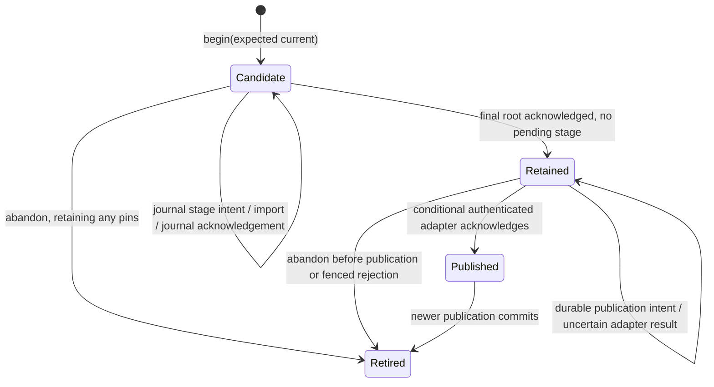

# Release-publication foundation (#737)

The host library in `ipfs::map` represents bounded immutable values.
`ipfs::release::Owner` journals release retention and publication transitions.
Neither module changes the running Host, deployment cache, release scripts,
CI publication holds, or production configuration.

## Map v1

A Map block is canonical DAG-CBOR `[1, {entries...}]`. Its CID is
CIDv1 / DAG-CBOR (`0x71`) / SHA-256 (`0x12`, 32 bytes).
Keys are exact UTF-8 strings. No Unicode normalization occurs.
Values are null, Boolean, signed i64, text, bytes, CID links, lists, or nested
string-key maps. CID links use tag 42 and a zero-prefixed binary CID.
The binary CID decoder consumes the full input and requires an exact round trip.
A link is a content identity; it does not authenticate or retain its target.

| Limit | Value |
| --- | ---: |
| Encoded block, including envelope | 1,048,576 bytes |
| Depth, excluding envelope | 32 |
| Total map entries, including nested maps | 4,096 |
| Total list elements, including nested lists | 16,384 |
| UTF-8 bytes per key | 1,024 |

Depth counts edges from the root map, which has depth zero. Empty containers
at depth 32 are accepted; their children would exceed the limit. The envelope
consumes neither map/list counters nor depth. The 1 MiB block limit follows
the existing composer profile and remains below the 2 MiB transport bound.
Golden files in `crates/ipfs/tests/fixtures/map` freeze the profile, bytes,
and CIDs.

The decoder rejects nonminimal integers/lengths, indefinite lengths, floats,
unsupported tags, duplicate or out-of-order keys, non-string keys, invalid
UTF-8, unknown envelope versions, trailing data, and exceeded limits. It checks
lengths and collection budgets before allocating decoded collections.
Canonical wire ordering follows encoded-key length then encoded-key bytes,
not ordinary string order. See the [DAG-CBOR specification](https://ipld.io/specs/codecs/dag-cbor/spec/).

`Map::get`, `iter`, `insert`, and `remove` operate on validated inline values.
Updates return new Maps. Iteration uses UTF-8 lexical order and returns at most
4,096 entries. `from_entries` bounds ingestion even for an unbounded iterator.
`encode` and `cid` are fallible. `persist` and `load` use an explicit async
`Blockstore`; `load` bounds acquisition and verifies the returned bytes.
The supplied store must honor its byte limit before allocating content.
Logical operations and Map destruction have no storage, pin, or cleanup effect.
CID equality is specific to this format; it is not promised across future
inline/tree representations. There is no guest WIT API or lazy traversal.

## One release owner

`Owner::open(existing_directory, domain)` holds an exclusive OS file lock for
its lifetime. All publishers for one release channel must use this same
private directory, including across process restarts. Each async method requires
an exclusive mutable borrow. A second owner for the same directory fails
immediately, rather than running competing retention/publication operations.

The operator must provision a durable private directory on a local filesystem
with advisory locks, atomic rename, file sync, and directory sync. The operator
must not replace the directory, delete its lock, restore an older snapshot,
or edit journal files while the owner operates. NFS, hostile directory writers,
and malicious filesystem rollback are outside this contract.

`domain` binds the journal to one operator-provisioned Kubo repository and
publication channel. Adapter domain mismatches fail before backend calls.
A domain string is not backend authentication or an exclusive Kubo pin claim.
Provisioning must route all channel publication through this owner and prevent
other clients from deleting its pins. Changing Kubo repositories requires
explicit migration; reusing the same label for an empty repository is invalid.
No second registry is added to the deployment cache.

## State and ordering



A generation identifies one journal record. `begin` rejects a stale expected
publication or a competing active candidate. An exact retry returns the active
generation. Generations are never reused. Publication generations order local
attempts; they do not prove source revision ancestry or consumer freshness.

`retain_stage` validates all supplied CID hashes and reachable links before
recording intent or calling Kubo. A stage must contain every reachable block,
except subgraphs rooted at this owner's previously acknowledged stage roots.
Merely finding a CID in Kubo does not authorize reuse. Retired acknowledged
stage roots remain eligible because retirement never removes their pins.
Duplicate supplied CIDs are charged against input bounds and deduplicated for
traversal. Unreachable supplied blocks are rejected.

Release blocks support raw, strict DAG-PB, and bounded DAG-CBOR profile values,
with SHA-256 CIDs. DAG-PB accepts both legal positions of the Data field and
rejects noncanonical link/CID fields. DAG-CBOR supports Map envelopes or
standalone bounded profile values. Unknown Map versions are rejected by
`Map::decode`; graph traversal does not interpret a standalone list as a
release descriptor. Descriptor/schema validation remains #738 work.

| Owner/import limit | Value |
| --- | ---: |
| Conservative encoded CAR charge per stage | 64 MiB |
| Supplied block | 2 MiB |
| Supplied block records per stage, including duplicates | 16,384 |
| Traversed links per stage | 65,536 |
| Recorded stages, including pending stages, across owner | 4,096 |
| Release records, including retired records | 256 |
| State file | 1 MiB |

These limits reject excess work; they do not silently prune history. At the
owner limits, coordinated migration or a separately reviewed compaction policy
is required. The caller supplies one bounded stage at a time. This owner does
not fetch remote descendants or accumulate a complete release in memory.
Existing `CaptureBatch` and snapshot APIs remain the artifact-acquisition
machinery for the future producer. #738 must connect acquisition to these
bounded stages without trusting arbitrary preexisting backend blocks.

`KuboRetention` reuses `HttpClient::import_composed`, with a positive configured
operation timeout. Kubo's CAR importer holds its GC lock through block import,
offline recursive pinning, and pin flush. The HTTP client consumes the entire
bounded response and rejects `PinErrorMsg`, malformed acknowledgements, and
streaming errors, including errors carried by HTTP 200 responses.
Each recorded stage root remains recursively pinned. Larger releases build
and acknowledge child stages before importing a parent that links those roots.

`finish_retention` requires an acknowledged stage for the exact final release
root. Only then can `publish` persist publication intent and invoke a publisher.
A successful publication moves the prior current record to Retired in the
same durable state replacement that selects the new Published record.

## Durable writes and recovery

The journal uses `owner.lock`, `state.json`, and at most one `state.next` file.
It follows the existing private-state write pattern in `rpc::keys`:
write temporary file, sync file, rename, sync directory. It adds exclusive
process locking, bounded state validation, and a persistent initialization
marker. A missing initialized journal is an error. Temporary files are never
recovery authority. Recovery rejects unknown versions, malformed/noncanonical
state, inconsistent transitions, missing retention evidence, and exceeded bounds.

A journal write failure poisons the owner handle, including failure after
rename. Further operations fail until the caller reopens and reconciles.
Durable writes contain no async cancellation points. They can briefly block
the calling thread; this is an offline publication library, not a guest I/O path.

| Interruption | Recovery |
| --- | --- |
| Before stage intent | Candidate remains; resupply stage. |
| During acquisition/import | Pending root remains; publication is forbidden. |
| Pin succeeded but acknowledgement was lost | `reconcile_retention` imports an empty CAR for the recorded root, recursively verifies/pins it, then journals acknowledgement. |
| Pending graph was incomplete | Reconciliation fails; resupply the exact immutable stage. |
| After acknowledgement, before Retained | Retry `finish_retention`. |
| After publication intent, before/after remote effect | Retry `publish` with the same generation and adapter. New candidates and retirement remain blocked. |
| Adapter gives terminal fenced rejection | Record becomes Retired; current publication does not advance. |
| After remote acknowledgement, before local commit | Same-intent retry reconciles the remote effect before recording Published. |
| During any snapshot replacement | Reopen the complete old or new snapshot; reject invalid state. |

The backend contract includes content integrity and durable recursive retention.
Storage corruption, backend data loss, external unpinning, and operator rollback
invalidate that contract; the journal is not a storage audit or repair service.
The implementation validates supplied content and closure, and Kubo checks
complete offline reachability during each recursive retention attempt.

## Publication and authentication boundary

`Publisher` has no production implementation. A CID, domain string, generation,
or successful retention is never accepted as authentication.

#738 must provide an adapter that:

1. Authenticates the exact selected descriptor/root and its artifact bindings.
2. Enforces revision ancestry, compatibility, and authorized rollback policy.
3. Binds the complete `PublicationIntent` to one stable channel and operation.
4. Conditionally applies the transition against `previous` and reconciles exact
   retries without regressing a newer authoritative value.
5. Treats cancellation/errors as uncertain results. If it returns `Rejected`,
   it must durably fence retries and delayed effects for that intent.

A plain IPNS PUT does not meet this contract. Existing signed-IPNS sequence and
record persistence machinery must be evaluated by #738; this owner does not
create another IPNS watermark or signing-key store. Consumer freshness and
legacy-reader migration also remain #738 responsibilities.

## Retirement and ownership

Kubo pins have CID identity, not independent reference counts. Shared descendants
and duplicate roots therefore do not authorize cleanup. `retire` changes only
journal metadata. `prune` always returns an ownership error. Neither the backend
trait nor the owner exposes unpin; destruction only releases the file lock.
Unknown import outcomes can leave extra retained or unpinned blocks. The owner
reports pending roots and retains evidence instead of guessing at cleanup.

## Validation and limits of evidence

Pure tests cover canonical bytes/CIDs, strict malformed inputs, all Map bounds,
immutable operations, and explicit in-memory storage. Owner fixtures cover
state ordering, loss of both acknowledgements, cancellation, stale/competing
candidates, domain mismatch, shared roots, journal bounds/corruption, write
failure poisoning, and refusal to prune.

The crash suite exits a subprocess without destructors at four filesystem
checkpoints for each of seven transition commits: Candidate, stage intent,
stage acknowledgement, Retained, publication intent, Published, and Retired.
The writes exercise actual file and directory sync. These are process-crash
tests, not simulated power cuts or proof of storage-controller persistence.

The opt-in Kubo 0.33.0 suite uses disposable offline repositories:

```sh
WW_TEST_REQUIRE_KUBO=1 cargo test -p ipfs --test release_kubo -- --nocapture
```

It checks GC blocked during a partially streamed CAR, a 72 MiB graph retained
through bounded stages, shared descendants, missing/corrupt supplied blocks,
HTTP-200 pin errors, cancellation after real retention, and lost acknowledgement
followed by abrupt Kubo restart and owner reconciliation. Publication remains
a fixture. Running without `WW_TEST_REQUIRE_KUBO` skips real Kubo execution.
No production Kubo, production IPNS identity, signing key, or publisher is used.
