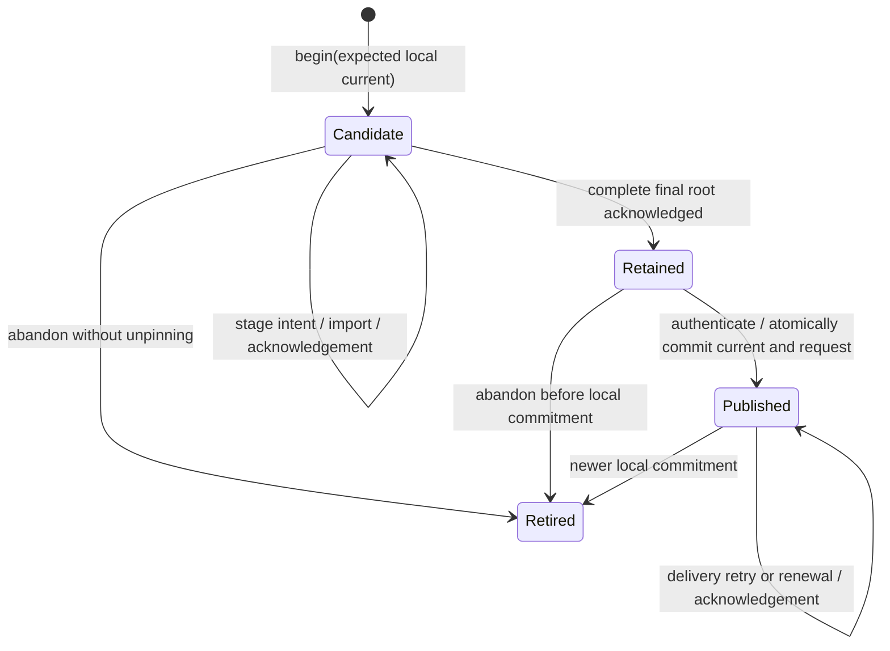

# Authenticated release publication (#737 / #738)

The host library in `ipfs::map` provides a bounded immutable inline IPLD Map,
initially used for release metadata.
`ipfs::release::Owner` journals release retention and publication transitions.
The dedicated publisher integrates these primitives with authenticated descriptors.
The running Host's deployment lifecycle and production publication hold remain
separate from official release publication.

## Map v1

A Map block is canonical DAG-CBOR `[1, {entries...}]`. Its CID is
CIDv1 / DAG-CBOR (`0x71`) / SHA-256 (`0x12`, 32 bytes).
Keys are exact UTF-8 strings. No Unicode normalization occurs.
Values are null, Boolean, signed i64, text, bytes, CID links, lists, or nested
string-key maps. CID links use tag 42 and a zero-prefixed binary CID.
The binary CID decoder consumes the full input and requires an exact round trip.
A link is a content identity; it does not authenticate or retain its target.

| Limit | Value |
| --- | ---: |
| Encoded block, including envelope | 1,048,576 bytes |
| Depth, excluding envelope | 32 |
| Total map entries, including nested maps | 4,096 |
| Total list elements, including nested lists | 16,384 |
| UTF-8 bytes per key | 1,024 |

Depth counts edges from the root map, which has depth zero. Empty containers
at depth 32 are accepted; their children would exceed the limit. The envelope
consumes neither map/list counters nor depth. The 1 MiB block limit follows
the existing composer profile and remains below the 2 MiB transport bound.
Golden files in `crates/ipfs/tests/fixtures/map` freeze the profile, bytes,
and CIDs.

The decoder rejects nonminimal integers/lengths, indefinite lengths, floats,
unsupported tags, duplicate or out-of-order keys, non-string keys, invalid
UTF-8, unknown envelope versions, trailing data, and exceeded limits. It checks
lengths and collection budgets before allocating decoded collections.
Canonical wire ordering follows encoded-key length then encoded-key bytes,
not ordinary string order. See the [DAG-CBOR specification](https://ipld.io/specs/codecs/dag-cbor/spec/).

`Map::get`, `iter`, `insert`, and `remove` operate on validated inline values.
Updates clone the bounded representation and return new Maps. Nested maps and
lists use ordinary Rust `BTreeMap` and `Vec` values, without structural sharing.
The entire Map encodes into one block. Iteration uses UTF-8 lexical order and
returns at most 4,096 entries. `from_entries` bounds ingestion even for an
unbounded iterator.
`encode` and `cid` are fallible. `persist` and `load` use an explicit async
`Blockstore`; `load` bounds acquisition and verifies the returned bytes.
The supplied store must honor its byte limit before allocating content.
Logical operations and Map destruction have no storage, pin, or cleanup effect.
CID equality is specific to this format; it is not promised across future
inline/tree representations. There is no guest WIT API or lazy traversal.

### Relationship to future persistent collections

`Value` is a versioned inline storage profile, not a universal Wetware value
model. This Map is not the definitive persistent-collection API explored in
[#698](https://github.com/wetware/ww/issues/698). Persistent Maps, bit-partitioned
vector tries, and other IPLD-backed collections may require different value
types, representations, APIs, and lifetime contracts.

That architecture will be revisited under #698 after the release/upgrade MVP.
The future work must evaluate reuse or evolution of this inline implementation
before introducing an independent Map. This foundation selects neither a
general value model nor a future collection API.

## One release owner

`Owner::open(existing_directory, domain)` holds an exclusive OS file lock for
its lifetime. All publishers for one release channel must use this same
private directory, including across process restarts. Each async method requires
an exclusive mutable borrow. A second owner for the same directory fails
immediately, rather than running competing retention/publication operations.

The operator must provision a durable private directory on a local filesystem
with advisory locks, atomic rename, file sync, and directory sync. The operator
must not replace the directory, delete its lock, restore an older snapshot,
or edit journal files while the owner operates. NFS, hostile directory writers,
and malicious filesystem rollback are outside this contract.

`domain` binds the journal to one operator-provisioned Kubo repository and
publication channel. Adapter domain mismatches fail before backend calls.
A domain string is not backend authentication or an exclusive Kubo pin claim.
Provisioning must route all channel publication through this owner and prevent
other clients from deleting its pins. Changing Kubo repositories requires
explicit migration; reusing the same label for an empty repository is invalid.
No second registry is added to the deployment cache.

## Approved publication model (#738)

The approved Option A supersedes #737's remote `Publisher` CAS contract.
`release::Owner` is authoritative for ordering inside the official publication
infrastructure. IPNS is eventually consistent discovery. Neither a successful
PUT nor a local lock fences delayed remote writes.

The dedicated Rust executable is `ww-release-publisher` in `wetware/ww`.
GitHub Actions builds, validates, signs, and initiates publication. The restricted
`wetware/infra` worker executes the publisher with infrastructure-owned storage
and Kubo. The normal `ww` Host consumes releases. Its deployment-IPNS publisher
and service lifecycle do not publish official releases.

Three events have different meanings:

| Event | Meaning |
| --- | --- |
| Local commitment | The owner selects a completely retained, authenticated release and persists its immutable announcement request in the same journal transaction. |
| Delivery acknowledgement | Kubo accepted one request for the committed root. The journal can record that acknowledgement. |
| Eventual discoverability | A consumer finds the signed IPNS record and fetches its release graph. No local transaction or acknowledgement proves this event globally. |

A delayed older request can finish after a newer request and temporarily expose
an older release. Consumers with an accepted signed release watermark reject
that release. A fresh consumer has no floor and cannot prove it found the latest
signed release through IPNS alone. The tracked
[`tests/publication-negative-control`](../tests/publication-negative-control/README.md)
reproduces the delayed-write counterexample with unmodified Boxo v0.27.2 and
LevelDB. The counterexample is regression evidence, not a production incident.

## State and ordering



`Published` names local commitment. It does not claim network convergence.
The local commit point is the successful `state.json` replacement followed by
parent-directory sync. The transaction retires the previous current release,
selects the new release, and stores its immutable announcement bytes. No remote
announcement occurs before that transaction succeeds.

`Publisher::prepare` authenticates the exact root, channel, release order, and
compatibility. It returns a bounded request and must not announce anything.
`Owner::commit_publication` stores that request after complete retention.
`Owner::publish` then delivers only the current committed request. Authentication
failure leaves the candidate Retained; the caller can correct input or retire it.
Transport errors and cancellation leave local commitment intact. There is no
terminal remote-fencing rejection outcome.

A new local commitment can supersede uncertain delivery. The owner refuses to
retry a superseded generation, but an earlier remote request can still complete.
Reannouncing the current request renews IPNS expiry. Kubo owns the existing
release discovery key. Kubo's transport sequence is independent of the signed
release descriptor sequence. Neither sequence proves Git ancestry.

`begin` checks the expected **local** current publication and rejects competing
active candidates. Exact retries reuse the same candidate. Generations identify
journal records; retired and abandoned generations are never reused. Signed
release sequences separately enforce consumer freshness and publication order.

## Bounded graph retention

`retain_stage` validates all CID hashes and reachable links before recording
intent or calling Kubo. Each stage contains every reachable block except
subgraphs rooted at this owner's acknowledged stage roots. Arbitrary existing
Kubo blocks are not retention evidence. Retired acknowledged roots remain usable
because retirement never removes pins. Unreachable supplied blocks are rejected.

The graph validator accepts raw, strict DAG-PB, and bounded DAG-CBOR with SHA-256
CIDs. `crate::map::links` extracts DAG-CBOR links. These storage types do not
select the persistent-collection architecture under #698.

| Bound | Value |
| --- | ---: |
| Conservative encoded CAR charge per stage | 64 MiB |
| Supplied block | 2 MiB |
| Supplied block records per stage | 16,384 |
| Traversed links per stage | 65,536 |
| Recorded stages across owner | 4,096 |
| Release records, including retired records | 256 |
| Immutable announcement request | 16 KiB |
| Journal snapshot | 1 MiB |

Bounds reject excess work without pruning. Coordinated migration or separately
reviewed compaction is required at capacity. Release packaging uses bounded
subtree stages and disk-backed blocks, so the complete release need not fit in
memory. Child stages are acknowledged before parent stages reuse their roots.

`KuboRetention` uses `HttpClient::import_composed` with a positive timeout.
Kubo holds its GC lock through import, offline recursive pinning, and pin flush.
The client consumes the complete bounded response and rejects pin errors,
malformed acknowledgements, and errors inside HTTP 200 responses.
`finish_retention` requires acknowledgement of the exact final release root.

## Durable writes and recovery

One private directory contains `owner.lock`, `state.json`, and at most one
`state.next`. Writes follow file write, file sync, atomic rename, and directory
sync. The owner holds an exclusive process lock throughout its operation.
`state.next` is never recovery authority. An initialized journal that loses
`state.json` fails closed. A failed write poisons the handle until reopen,
including failure after rename. Synchronous commits contain no cancellation point.

Journal version 2 records the approved local-authority model. Version 1 journals
fail closed; they must not be relabeled or automatically interpreted as local
commitment. Any existing v1 journal requires an operator-reviewed migration that
reconciles its old remote assumptions. This assignment migrates no production state.

| Interruption | Recovery |
| --- | --- |
| Before stage intent | Resupply the candidate stage. |
| During import | Pending root blocks local commitment. |
| Retention succeeded; acknowledgement lost | Reconcile with an empty CAR under the Kubo GC lock, or resupply the immutable stage. |
| After all stages; before Retained | Retry `finish_retention`. |
| During authentication/preparation | No announcement is permitted; retry preparation. |
| During local commit | Reopen old or new complete snapshot; temporary files cannot select authority. |
| After local commit; before/during delivery | Current release and exact request survive; retry current delivery. |
| Delivery acknowledged; journal acknowledgement lost | Retry current request; duplicate delivery is allowed. |
| Older delivery finishes after supersession | Local current stays newer; consumers enforce their signed release floor. |
| IPNS expiry approaches | Reannounce current root under the same owner lock. |

The backend contract requires content integrity and durable recursive retention.
External unpinning, storage loss, hostile journal writers, and filesystem rollback
invalidate that contract. The journal is not a storage repair service.

## Authentication and release graph

`release_descriptor::Descriptor` uses canonical versioned IPLD Map bytes.
The descriptor contains real links to the FHS and native artifacts, platform
and ABI identity, file sizes and SHA-256 digests, actual source/build provenance,
and the Host/PID0 compatibility profile. Runtime file digests differ from UnixFS
storage-root identities. Reused Host artifacts retain their actual build revision.

The graph remains acyclic: artifact roots → descriptor → `RELEASE-DESCRIPTOR`
binding → manifest → detached signature → final UnixFS transport root. The final
root directly links the descriptor as `release-descriptor` and preserves legacy
installer paths. The binding is exactly canonical descriptor CID text plus LF;
its ordinary SHA-256 entry is signed by the existing #412 Ed25519 authority.
The descriptor never includes the signature, manifest hash, or enclosing root.

Consumers authenticate the manifest and binding before descriptor interpretation.
Artifact selection requires a supported platform, matching compatibility profile,
and verified artifact bytes. The consumer watermark stores the raw signed IPNS
record and authenticated release proof in one locked durable state file. It
rejects lower IPNS sequences, equal-IPNS-sequence value changes, lower signed
release sequences, and equal-release-sequence descriptor changes. Expiry does not
erase either floor. Explicit historical selection authenticates and checks
compatibility without updating channel freshness state.

The existing shell installer continues to authenticate its manifest and payloads.
It does not interpret descriptors or persist freshness watermarks. Legacy readers
therefore retain their existing replay limitation during migration. #739 owns
Host replacement; #740 owns CLI migration. Neither is implemented here.

## Retirement and ownership

Kubo pins have CID identity, not independent reference counts. Shared descendants
and duplicate roots therefore do not authorize cleanup. `retire` changes only
journal metadata. `prune` always returns an ownership error. Neither the backend
trait nor the owner exposes unpin; destruction only releases the file lock.
Unknown import outcomes can leave extra retained or unpinned blocks. The owner
reports pending roots and retains evidence instead of guessing at cleanup.

## Validation and limits of evidence

Pure tests cover canonical bytes/CIDs, strict malformed inputs, all Map bounds,
immutable operations, and explicit in-memory storage. Owner fixtures cover
state ordering, loss of both acknowledgements, cancellation, stale/competing
candidates, domain mismatch, shared roots, journal bounds/corruption, write
failure poisoning, and refusal to prune.

The crash suite exits a subprocess without destructors at four filesystem
checkpoints for each of seven transition commits: Candidate, stage intent,
stage acknowledgement, Retained, local commitment, delivery acknowledgement, and Retired.
The writes exercise actual file and directory sync. These are process-crash
tests, not simulated power cuts or proof of storage-controller persistence.

The opt-in Kubo 0.33.0 suite uses disposable offline repositories:

```sh
WW_TEST_REQUIRE_KUBO=1 cargo test -p ipfs --test release_kubo -- --nocapture
```

It checks GC blocked during a partially streamed CAR, a 72 MiB graph retained
through bounded stages, shared descendants, missing/corrupt supplied blocks,
HTTP-200 pin errors, cancellation after real retention, and lost acknowledgement
followed by abrupt Kubo restart and owner reconciliation. Publication remains
a fixture. Running without `WW_TEST_REQUIRE_KUBO` skips real Kubo execution.
The independent executable suite uses isolated Kubo 0.43.1 over a Unix socket:

```sh
python3 tests/test_release_publisher.py --binary target/debug/ww-release-publisher --ipfs /path/to/kubo-0.43.1/ipfs --fhs target/fhs
```

It exercises real FHS preparation, five Host fixture artifacts totaling 80 MiB,
14 bounded stages, remote acquisition, retained-root checks before announcement,
lost acknowledgement, process retry, current-root renewal, legacy path reads,
and invalid trust. Bootstrap and swarm listeners are disabled. This does not
qualify the Linux infrastructure cgroup, public-network reachability, convergence,
or cross-platform native execution. No production Kubo, production IPNS identity,
release key, or publisher is used.
